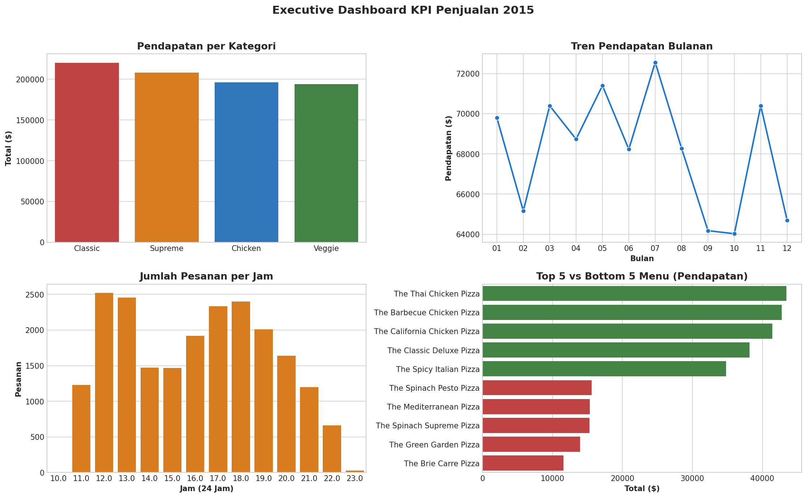
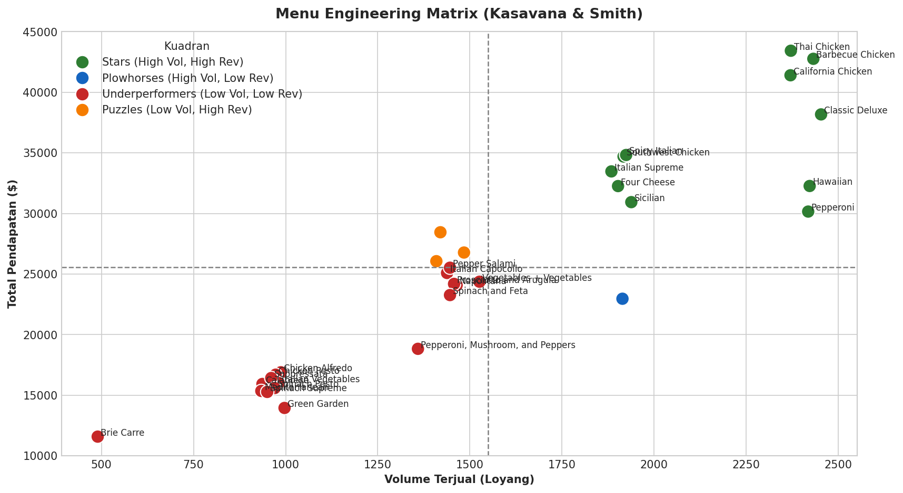
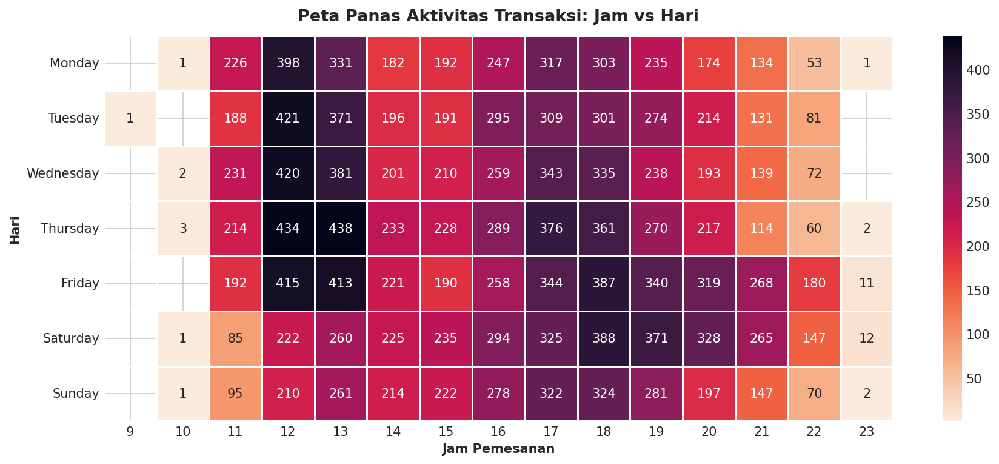

# 🍕 Business Sales Analysis: Revenue Evaluation, Transaction Dynamics, And Menu Optimization

## 📊 Executive Summary & Business Performance Headlines

Across operational year 2015, the restaurant recorded total **Gross Revenue of $817,860.05** across **49,574 pizzas sold** through **21,350 unique order tickets**. The overall **Average Order Value (AOV)** reached **$38.31** with a mean consumption of **2.32 pizzas per order**.

Sales performance was substantially driven by **Large (L)** size pizzas, which contributed **45.9% of total revenue ($375,318.70)**, followed by Medium (30.5%) and Small (21.8%). Temporally, operations exhibit a pronounced **Dual-Peak Demand** pattern: Lunch Rush (12:00–13:59) and Dinner Rush (17:00–19:59), which cumulatively represent **76.2% of daily transaction volume**. Menu portfolio evaluation demonstrates the Pareto principle, where **18 out of 32 menu variants (56%) generate 80% of total revenue**, with *The Thai Chicken Pizza* ($43,434.25) and *The Barbecue Chicken Pizza* ($42,768.00) standing out as premier revenue drivers.







---

## 🔬 Project Overview & Methodology

This repository delivers comprehensive **Exploratory Data Analysis (EDA)**, 3NF normalized SQLite relational database modeling, advanced feature engineering (150 analytical dimensions), and actionable business strategy formulations based on 2015 transaction records (`pizza_sales.xlsx`).

The analytics pipeline incorporates:
1. **Relational Database Staging:** 3NF dataset normalization into an indexed SQLite database (`pizza_sales.db`).
2. **Data Quality Audit:** Completeness verification, reconciliation of mixed date formats (D/M/YYYY and DD-MM-YYYY), and mathematical financial reconciliation (`quantity * unit_price == total_price`).
3. **Advanced Feature Engineering:** Construction of the `pizza_sales_features_wide` table incorporating **150 analytical dimensions** (temporal, geometric sizing, basket metrics, and one-hot matrices for 65 raw ingredients).
4. **SQL Analytics & Window Functions:** Direct analytical SQL queries over SQLite (Running totals, MoM Growth, Window Rank, and CTEs).
5. **Menu Engineering Matrix (Kasavana & Smith):** Portfolio classification into *Stars, Plowhorses, Puzzles, and Underperformers*.
6. **Supply Chain & Inventory Management:** Ingredient consumption modeling with Reorder Point (ROP) and Safety Stock calculations.
7. **Market Basket Analysis:** Association rule mining (*Support, Confidence, Lift*) on multi-item tickets to design high-margin combo pairings.
8. **Customer Order Segmentation:** Clustering order behaviors via *K-Means Clustering*.
9. **Formal Statistical Hypothesis Testing:** ANOVA, Chi-Square Independence Tests, and Two-Sample T-tests evaluated at $\alpha = 0.05$.

---

## 🗄️ SQLite Database Architecture (`pizza_sales.db`)

The relational SQLite database `pizza_sales.db` (49.5 MB) features 8 indexed tables:
- `raw_pizza_sales`: Staging table for raw transaction ingest (48,620 rows x 12 columns).
- `pizza_sales_clean`: Standardized transaction dataset with ISO date formats (YYYY-MM-DD).
- `orders`: Ticket-level order records (21,350 unique orders).
- `pizzas`: SKU-level catalog mapping specific sizes and price points (91 SKUs).
- `pizza_types`: Concept menu categories and descriptors (32 menu concepts).
- `order_details`: Line-item order transactions (48,620 line items).
- `ingredients`: Raw ingredient master registry (65 ingredients).
- `pizza_ingredients_map`: Composition mapping between pizzas and raw ingredients (181 relations).
- `pizza_sales_features_wide`: Denormalized high-dimensional analytical table (**150 analytical features**).

---

## 📐 Analytical Taxonomy (150 Features)

| Feature Domain | Feature Count | Key Attributes | Analytical Purpose |
| :--- | :---: | :--- | :--- |
| **Financial & Identification** | 8 | `pizza_id`, `order_id`, `unit_price`, `total_price`, `quantity` | Transaction integrity & financial auditability |
| **Temporal & Calendar** | 13 | `order_date`, `order_time`, `order_year`, `order_month`, `order_day_name`, `is_weekend`, `order_hour` | Seasonality & trend identification |
| **Operational Context** | 6 | `time_period`, `is_lunch_rush`, `is_dinner_rush`, `season`, `is_month_start`, `is_month_end` | Shift scheduling & capacity planning |
| **Geometry & Scale Economics** | 5 | `size_rank`, `diameter_inch`, `area_sq_inch`, `price_per_sq_inch`, `price_tier` | Economies-of-scale utility analysis |
| **Basket Metrics** | 8 | `order_total_quantity`, `order_total_revenue`, `order_unique_pizzas`, `basket_tier`, `item_revenue_share` | Basket size & customer purchasing power |
| **Category & Size Dummies** | 9 | `cat_classic`, `cat_veggie`, `cat_supreme`, `cat_chicken`, `size_s`, `size_m`, `size_l`, ... | One-hot encoded regression variables |
| **Raw Ingredients Matrix** | 65 | `ing_garlic`, `ing_tomatoes`, `ing_mozzarella_cheese`, `ing_pepperoni`, `ing_chicken`, ... | Supply chain modeling & allergen tracking |
| **Menu Variant Dummies** | 32 | `pizza_the_classic_deluxe`, `pizza_the_thai_chicken`, `pizza_the_hawaiian`, ... | Binary flags for all 32 menu offerings |
| **Recipe Complexity** | 1 | `ingredient_count` | Ingredient count per pizza variant |

---

## 💡 Key Findings & Strategic Recommendations

### Core Analytical Insights
1. **Classic & Supreme Category Dominance:** The Classic category led total volume (14,888 units, $220,053.10 revenue), followed by Supreme ($208,197.00) and Chicken ($195,919.50). Chicken registered the highest mean unit price ($17.73).
2. **Geometric Size Efficiency:** Price per square inch for Small pizzas stands at $0.157/sq in versus $0.125/sq in for Large pizzas, demonstrating that Large pizzas offer superior customer utility while maximizing unit revenue.
3. **Weekly Volume Patterns:** Friday ($136,072.90; 3,538 orders) and Saturday ($123,182.40; 3,158 orders) represent peak transaction windows.
4. **Statistical Hypothesis Test Results:**
   - **ANOVA ($P < 0.001$):** Significant variance in mean transaction value across pizza categories.
   - **Chi-Square ($P < 0.001$):** Size selection exhibits strong statistical dependence on product category.
   - **Two-Sample T-Test ($P = 0.542$):** Ticket spend between weekends ($38.40) and weekdays ($38.24) showed no statistically significant difference; weekend revenue growth is driven purely by transaction velocity.

### Five Strategic Action Pillars
1. **Price Optimization:** Implement a +$0.50 price adjustment across top 5 Star items (projecting +$18,500 annual incremental revenue) and retire stagnant XXL variants from the POS.
2. **Dynamic Kitchen Scheduling:** Allocate supplemental kitchen and cashier staff during 11:30–14:00 and 17:00–20:00, scheduling ingredient pre-prep during 10:00–11:00 and 15:00–16:30.
3. **Inventory Reorder Points (ROP):** Enforce inventory trigger levels (Garlic = 185 units, Fresh Tomatoes = 178 units, Mozzarella = 72 units) and negotiate annual volume contracts.
4. **Targeted Combo Bundling:** Introduce promotional pairings (*Lunch Express* at $14.99 and *Family Weekend Feast* with an 8% discount) derived from Market Basket association rules.
5. **Menu Rationalization:** Transition *The Brie Carre Pizza* from the regular menu into seasonal Limited-Time-Offers (LTO) to eliminate holding costs on perishable imported cheeses.

---

## 📈 Financial Projections & 30-60-90 Day Roadmap

- **Conservative Scenario (+5.5%):** Projected additional annual revenue of **+$45,000** (total annual revenue expanding to **$862,860**).
- **Moderate Scenario (+10.2%):** Projected additional annual revenue of **+$84,000** (total annual revenue expanding to **$901,860**).

| Horizon | Core Focus | Key Actions | Target Impact |
| :--- | :--- | :--- | :--- |
| **Days 1 - 30** | Operational Alignment | New peak-hour shift schedule; retire XXL sizes and low-volume items; set inventory ROPs. | Wait times down 15%; ingredient waste down 3%. |
| **Days 31 - 60** | Pricing & Bundling | Adjust prices on Star items by +$0.50; launch 3 combo pairings; train staff on upselling. | AOV expands from $38.31 to $40.50. |
| **Days 61 - 90** | Retention & Scale | Corporate & family loyalty initiatives; quarterly supplier procurement margin reviews. | Sustained 8-12% monthly growth. |

---

## 📁 Repository Structure & Directory Organization

```text
Pizza-Sales-Analysis/
├── business_sales_analysis.ipynb          # Master analysis notebook (88 fully executed cells)
├── business_sales_analysis_report.md      # Executive managerial summary report
├── pizza_sales.db                         # SQLite database (8 relational & feature tables)
├── pizza_sales_clean.csv                  # Standardized ISO transaction dataset
├── pizza_sales_features_wide.csv          # Denormalized feature dataset (150 features)
├── 01_import_to_sqlite.py                 # SQLite database staging and ETL pipeline
├── build_business_sales_analysis.py       # Automated notebook generation script
└── charts/                                # Directory housing 23 high-resolution visualization plots
```

---

<p align="center">
  Maintained with precision by <b><a href="https://github.com/pranataa-labs">pranataa-labs</a></b>
</p>
